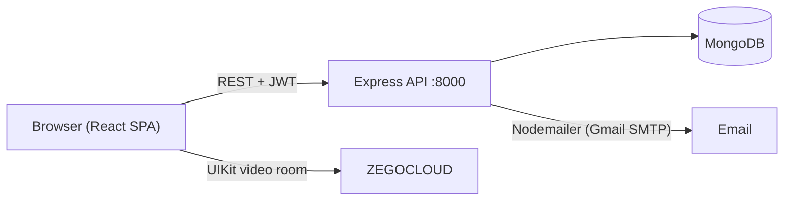

# Clinic Management

A web application for a small clinic: patients book in-person or online appointments with doctors, doctors keep medical records and prescriptions, and administrators manage staff, schedules, medicines and content. Team project built between September 2024 and January 2025. The user interface is in Vietnamese.

## Overview

Booking a clinic visit often still means phone calls and paper records. This project puts the whole flow in one app. Patients pick a doctor and a free time slot. Online visits get a browser video room. The doctor records the visit, with symptoms, diagnosis, treatment plan and prescriptions taken from the clinic's medicine stock. Administrators manage the clinic's data and follow appointment and medicine-sales statistics.

The app has a React single-page client and an Express REST API backed by MongoDB.

## Key features

**Patients**
- Register and log in (bcrypt-hashed passwords, JWT sessions).
- Browse and search doctors by specialty, view a doctor's profile and free time slots.
- Book an appointment as **in-person** or **online**. The server rejects double-booking of a slot and creates the patient's medical record on the first booking.
- Receive a booking confirmation email. Cancel an appointment with a reason, which is emailed to the doctor.
- See upcoming appointments with a countdown, and join online consultations in a browser video room (ZEGOCLOUD UIKit).
- Manage profile details and change password.
- Public pages: clinic introduction, service price list, medicine catalogue, and a news/blog section with categories and view counts.
- A keyword-based help chatbot. It returns preset advice for common symptoms and links to booking pages. It is rule-based, not AI.

**Doctors**
- View their appointment schedule and open the video room for online visits.
- View a patient's medical record and add a visit with symptoms, diagnosis, treatment plan, notes and prescriptions. Prescribed quantities are deducted from medication stock.

**Administrators**
- Create, update and delete doctors, patients, medications, clinic services and blog posts.
- Create doctor work schedules split into bookable time slots.
- Dashboards (Recharts): appointments by specialty, per-doctor daily and monthly counts, average consultation time, medication sales, best sellers and monthly revenue.

## Tech stack

| Layer | Technology |
|---|---|
| Client | React 18, Vite 5, React Router 6, Ant Design 5, MUI 6, React-Bootstrap, Sass, Recharts, react-toastify, axios |
| Video calls | ZEGOCLOUD UIKit Prebuilt (`@zegocloud/zego-uikit-prebuilt`) |
| API | Node.js, Express 4, jsonwebtoken, bcryptjs, Nodemailer |
| Database | MongoDB with Mongoose 8 |
| Tooling | npm, nodemon, ESLint (client) |

## Architecture



- **Server layers:** `routes/` → `controllers/` → `service/` → Mongoose `models/`. `server.js` mounts 12 routers under `/api`, connects to MongoDB and seeds a default admin account if none exists.
- **Auth:** `POST /api/auth/login` returns a JWT (1 hour) and the user's role. The client stores both in cookies and sends `Authorization: Bearer <token>`. The `authenticate` and `authorize([...roles])` middlewares protect routes.
- **Booking flow:** the client calls `POST /api/appointment/book-appointment`, then `POST /api/email/send-email` to send the confirmation. Cancellation calls `send-cancellation-reason`, then deletes the appointment.
- **Data model:** `User` (patients, doctors and admins in one collection, by `role`), `Schedule` (slots per doctor per day), `Appointment`, `AppointmentCancel`, `MedicalRecord` (embedded visit history), `Prescription`, `Medication`, `Service`, `Blog`.

## Project structure

```text
Clinic-Management/
├── client/                    # React + Vite SPA
│   ├── src/
│   │   ├── pages/
│   │   │   ├── users/         # Home, doctor list/profile, booking, profile
│   │   │   ├── Doctor/        # Doctor schedule and patient records
│   │   │   ├── admin/         # Admin dashboard and management pages
│   │   │   ├── Blog/          # News list and article pages
│   │   │   └── videocall/     # Video consultation room
│   │   ├── components/        # Modals, layout, chatbot, charts, route guards
│   │   ├── utils/             # API wrappers per domain
│   │   ├── config/            # Axios instance with JWT interceptor
│   │   └── style/             # SCSS per page
│   └── .env.development       # VITE_BACKEND_URL for local dev
└── server/                    # Express REST API
    ├── routes/ controllers/ service/ models/
    ├── middlewares/           # authenticate, authorize
    ├── seeders/               # Admin seeder + fake-data scripts
    └── server.js
```

## Getting started

**Prerequisites:** Node.js 18+ and npm, plus a MongoDB database (local or Atlas).

1. Configure and start the API:

   ```bash
   cd server
   cp .env.example .env      # then fill in MONGO_URI and JWT_SECRET
   npm install
   npm run dev               # nodemon server.js → http://localhost:8000
   ```

2. Start the client in a second terminal:

   ```bash
   cd client
   npm install
   npm run dev               # http://localhost:5173
   ```

   `client/.env.development` already points `VITE_BACKEND_URL` at `http://localhost:8000`.

3. Sign in. Patients and doctors use `/login-register`, admins use `/admin/login`. On startup the server creates a default admin (`admin@example.com`, defined in `server/seeders/seedAdmin.js`) if one does not exist. Change its password immediately.

**Optional sample data:** `server/seeders/seedUsers.js` and `server/seeders/addFakeImage.js` generate fake doctors and patients. Point their connection string at your own database and install `@faker-js/faker` first. Then run, for example, `node seeders/seedUsers.js` from `server/`.

## Environment variables

**Server** (`server/.env`, see `server/.env.example`)

| Name | Required | Description |
|---|---|---|
| `MONGO_URI` | Yes | MongoDB connection string |
| `JWT_SECRET` | Yes | Secret used to sign and verify JWTs. Use a long random value. |
| `PORT` | No | API port (default `8000`) |
| `EMAIL_USER` / `EMAIL_PASS` | Yes, for email | Gmail address and app password used by Nodemailer |

**Client** (`client/.env.development` or `client/.env.local`, see `client/.env.example`)

| Name | Required | Description |
|---|---|---|
| `VITE_BACKEND_URL` | Yes | Base URL of the API, e.g. `http://localhost:8000` |
| `VITE_ZEGO_APP_ID` / `VITE_ZEGO_SERVER_SECRET` | Yes, for video calls | ZEGOCLOUD UIKit credentials. The test kit token is generated in the browser, so this secret is visible to users of a deployed build — see [Known limitations](#known-limitations). |

The seed scripts in `server/seeders/` read `MONGO_URI` from `server/.env` as well.

## API reference

All paths are prefixed with `/api`. Auth: **Public** = no token, **JWT** = any signed-in user, otherwise the roles listed.

| Method | Path | Auth | Description |
|---|---|---|---|
| POST | `/auth/register` | Public | Register a patient |
| POST | `/auth/login` | Public | Log in, returns JWT and role |
| PUT | `/auth/change-password` | JWT | Change own password |
| GET | `/user/users/:id` | JWT | Get a user profile |
| PUT | `/user/edit-users/:id` | JWT | Update a user profile |
| POST | `/admin/create-doctor` | admin | Create a doctor account |
| POST | `/admin/create-patient` | admin, doctor | Create a patient account |
| GET | `/admin/users` | Public | List users by role |
| DELETE | `/admin/delete-users/:id` | admin | Delete a user |
| GET | `/admin/count-userbyRole` | admin | Count users per role |
| POST | `/admin/doctor-specialties` | Public | Doctors by specialty |
| GET | `/admin/search-doctor` | Public | Search doctors |
| POST | `/schedule/create-schedual` | admin | Create a doctor's work schedule |
| GET | `/schedule/get-schedual/:doctorId` | JWT | A doctor's schedules and slots |
| GET / PUT / DELETE | `/schedule/doctor-schedule`, `/schedule/update-schedules/:id`, `/schedule/delete-schedule/:id` | Public | Admin schedule listing and edits |
| POST | `/appointment/book-appointment` | JWT | Book an appointment |
| PUT | `/appointment/confirm/:id` | admin | Confirm an appointment |
| DELETE | `/appointment/cancel/:id` | JWT | Cancel (delete) an appointment |
| GET | `/appointment/patient/:patientId` | JWT | A patient's appointments |
| GET | `/appointment/doctor/:doctorId`, `/appointment/doctor-appointments/:doctorId` | JWT | A doctor's appointments (with patient info) |
| GET | `/appointment/appointments/:doctorId` | Public | Booked slots of a doctor |
| POST | `/medicalRecord/create` | JWT | Create a medical record |
| POST | `/medicalRecord/:patientId/add-visit` | doctor | Add a visit with prescriptions |
| GET | `/medicalRecord`, `/medicalRecord/:patientId` | Public | List records / a patient's record |
| GET | `/medicines/all-medicines` | Public | Medicine catalogue |
| POST / PUT / DELETE | `/medicines/create-medicine`, `/update-medicine/:id`, `/delete-medicine/:id` | admin (create also doctor) | Manage medicines |
| GET | `/services/all-services` | Public | Clinic services and prices |
| POST / PUT / DELETE | `/services/create-services`, `/update-services/:id`, `/delete-services/:id` | admin | Manage services |
| GET | `/blog/get-all-blogs`, `/blog/get-blog-by-id/:id` | Public | Read posts |
| POST | `/blog/tin-tuc/the-loai`, `/blog/increment-views/:id` | Public | Posts by category, view counter |
| POST / PUT / DELETE | `/blog/create-blog`, `/update-blog-by-id/:id`, `/delete-blog-by-id/:id` | admin | Manage posts |
| GET | `/statics/*` | Public | Appointment statistics |
| GET | `/medications/*` | Public | Medication sales and revenue statistics |
| POST | `/email/send-email`, `/email/send-cancellation-reason` | Public | Send booking and cancellation emails |

## Known limitations

- **Client-side video token.** The ZEGOCLOUD kit token is generated in the browser from the server secret (UIKit test mode). A production setup should issue tokens from the API instead.
- **Authorization gaps.** Several routes marked *Public* above should require authentication, especially medical records, user listing, schedule edits and email sending. `edit-users/:id` does not check that the caller owns the account.
- **SMS confirmation does not work.** `confirmAppointment` still calls a removed `sendSMS` helper. Email is the only working notification channel, and the client triggers it.
- **Fresh databases.** The default admin seeder uses a `gender` value that the `User` schema rejects (`Nam`/`Nữ` only). On an empty database, change it before the first start.
- The online-visit link is built with a hardcoded `http://localhost:5173` host.
- Mostly desktop layouts. Several UI libraries are mixed. No automated tests.
- No live deployment is currently maintained.

## Related repository

[`Smart-clinic-management-system`](https://github.com/tinhne/Smart-clinic-management-system) is an older snapshot of this repository (December 2024). **This repository is the canonical, more complete version.**

## Team

Built by a team of four (names as they appear in the commit history):

- **ntn1105**: authentication and JWT middleware, email notifications, video-call room, admin and booking pages, blog, statistics
- **tandung10**: admin management pages (doctors, patients, medicines, schedules), data models, user pages
- **HO PHUC HIEU** (also committing as *Hiếu Pandora*): help chatbot and its response data, home page and blog UI, medicine pages, setup notes (`README.txt`)
- **Lê Văn Trung Tính** (tinhne): project setup, first appointment-booking service, patient appointment management (list, countdown, cancel with reason), profile and password pages, the doctor-side medical-record and prescription workflow (`medicalRecordService`, add-visit modal, patient records, schedule view), medication sales statistics, and fake-data seeders

## Author

Contributor: **Lê Văn Trung Tính** — Software Engineer | AI Product Builder

- Website: [trungtinh.site](https://trungtinh.site)
- GitHub: [@tinhne](https://github.com/tinhne)
